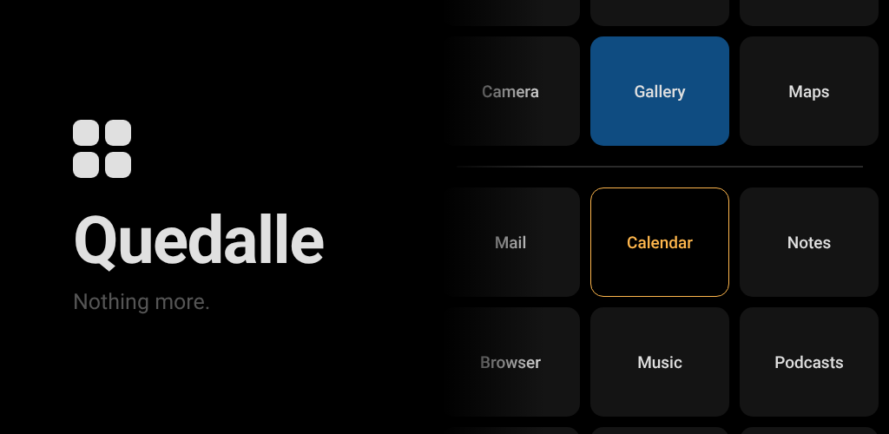
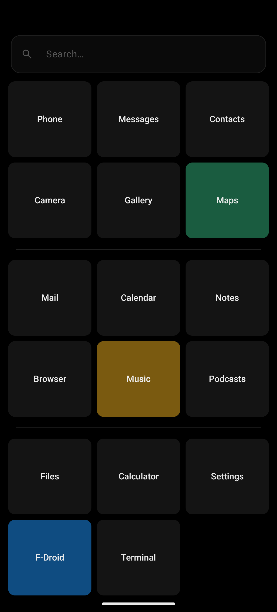
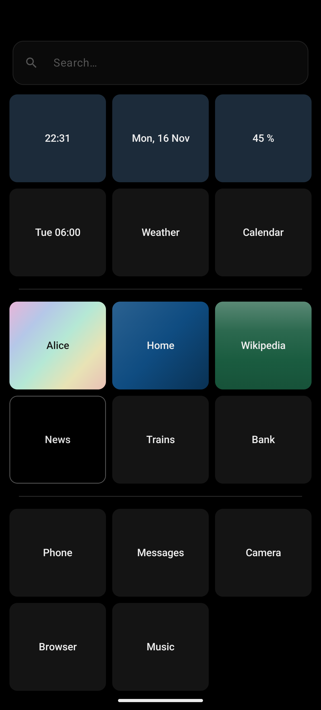
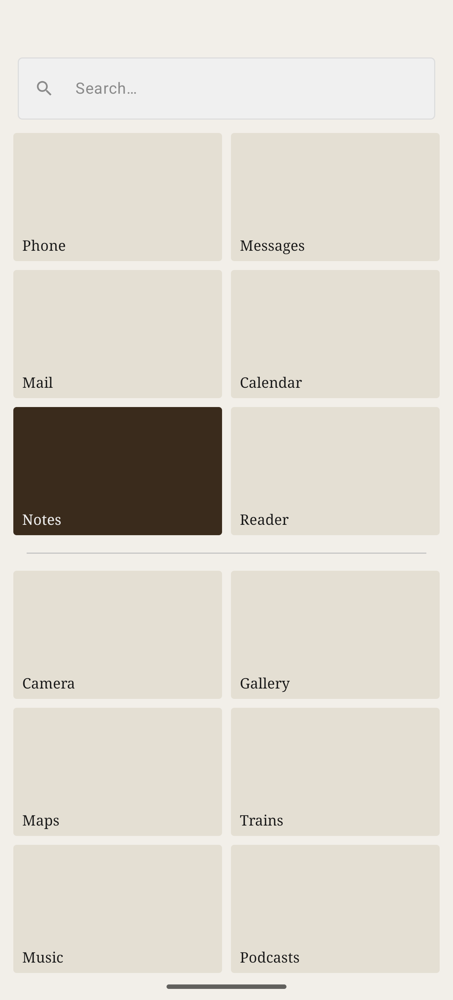
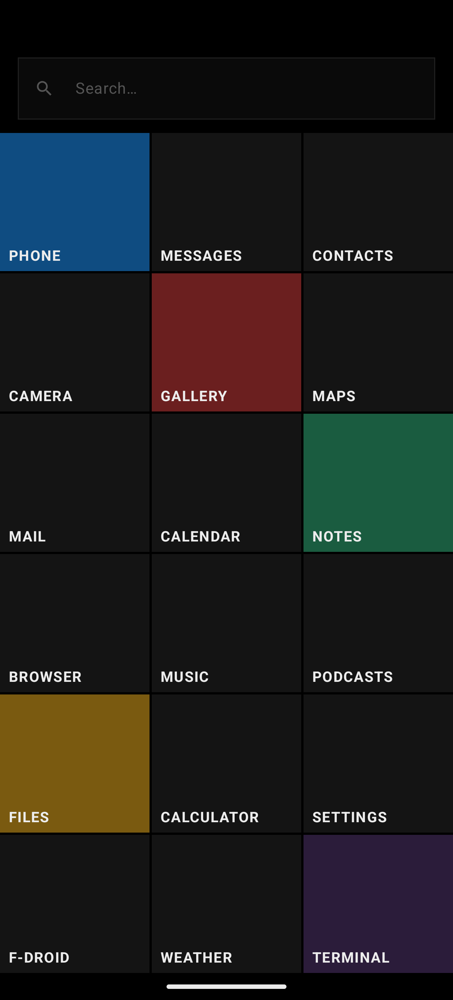
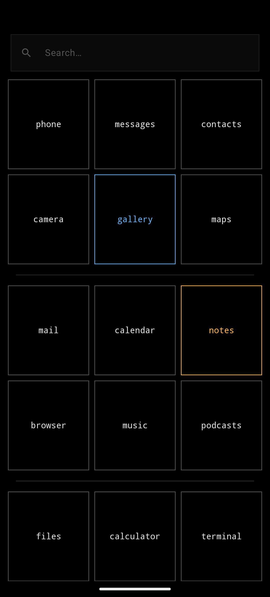

# Quedalle

A minimal, tile-based Android home screen launcher built with Jetpack Compose.

> *Quedalle* — French slang for "absolutely nothing". Because that's how much bloat this launcher has.

The home screen is intentionally finite: it holds exactly what fits the grid
you configured, nothing more. No pages, no app drawer, no widgets, no icons —
just text on tiles.

[](https://f-droid.org/packages/dev.mlg.quedalle/)

## Screenshots

| Home | Info & shortcuts | Paper | Mosaic | Outline |
|---|---|---|---|---|
|  |  |  |  |  |

The same launcher five times: only the settings differ.

## Features

### Tiles

- **App tiles** — your essential apps, text only, renameable
- **Shortcut tiles** — an app's shortcut (a conversation, a route), a contact or a web link
- **Info tiles** — time, date, battery level, next alarm, as plain text
- **Spacers and dividers** — colored blanks and thin lines to structure the grid
- **Layouts** — several grids (work, weekend…) you switch between by hand
- **Drag & drop** — long-press any tile to reorder

### Look

- **Colors and textures** — a global tile style plus per-tile overrides: background and text colors (presets or custom HSL), textures (outline, iridescent, gradient, glass), edited live from a single long-press sheet
- **Shape** — corner radius, spacing and outer margin, down to a square edge-to-edge mosaic
- **Text** — size, font (system, serif, monospace), letter case, position in the tile, weight
- **Theme** — light or dark, following the system or forced, with a choice of screen background
- **Ready-made looks** — Black, Paper, Outline, Mosaic: one tap sets it all

### Everyday

- **Search** — accent-insensitive inline search of installed apps
- **Hide apps** — keep apps out of search results
- **Gestures** — swipe down, swipe up and double tap, each bound to an action or an app
- **Work profile** — apps from all profiles, with badged labels
- **Private space** (Android 15+) — its apps show only while it is unlocked
- **Backup** — export/import the whole configuration as a JSON file

### Privacy

- No internet permission, no accounts, no analytics, no tracking
- Nothing leaves the device: the only way out is the backup file you export yourself

## Install

Get it on [F-Droid](https://f-droid.org/packages/dev.mlg.quedalle/), or grab an APK
from the [releases page](https://github.com/MatthieuGrr/quedalle-launcher/releases)
(release APKs are unsigned — F-Droid builds and signs its own).

Requires Android 8.0 (API 26) or higher.

## Permissions

| Permission | Why |
|---|---|
| `REQUEST_DELETE_PACKAGES` | Offer "Uninstall" in the app long-press menu |
| `EXPAND_STATUS_BAR` | Open the notification shade or quick settings from a gesture |
| `ACCESS_HIDDEN_PROFILES` | List the apps of the Android 15 private space while it is unlocked |

All three are `normal`-level permissions (auto-granted, read nothing). No internet
permission, no contacts permission, no notification access, no accessibility service.

**Contact tiles** use the system contact picker, which hands over the one
contact you choose — Quedalle cannot read your address book.

## Build from source

```bash
git clone https://github.com/MatthieuGrr/quedalle-launcher.git
cd quedalle-launcher
./gradlew assembleRelease
```

Output APK: `app/build/outputs/apk/release/app-release-unsigned.apk`

Run the unit tests with `./gradlew test`.

## Contributing

Issues and pull requests are welcome. Before opening a pull request:

- run `./gradlew testDebugUnitTest lintDebug` — CI runs the same checks;
- add every user-visible string in both `values/strings.xml` (English) and
  `values-fr/strings.xml` (French);
- keep to the spirit of the launcher: text on tiles, nothing that needs the
  network or a sensitive permission.

The store presentation lives in `fastlane/metadata/android/` (descriptions,
screenshots, changelogs, one folder per language). The feature graphic is
rendered from `tools/feature-graphic/banner.html`, which uses the app's own
palette: `node tools/feature-graphic/render.js` (needs Playwright).

### Releasing

Bump `versionCode` and `versionName` in `app/build.gradle.kts`, add a
`changelogs/<versionCode>.txt` (500 characters at most) in each language, then
tag the commit (`v3.0`), or run the *Release* workflow with that tag. F-Droid
picks up new tags on its own and builds the version whose `versionCode` went up;
its build recipe lives in
[fdroiddata](https://gitlab.com/fdroid/fdroiddata/-/blob/master/metadata/dev.mlg.quedalle.yml).

## License

[GPL-3.0-only](LICENSE) — Copyright (C) 2024 Matthieu Georger
